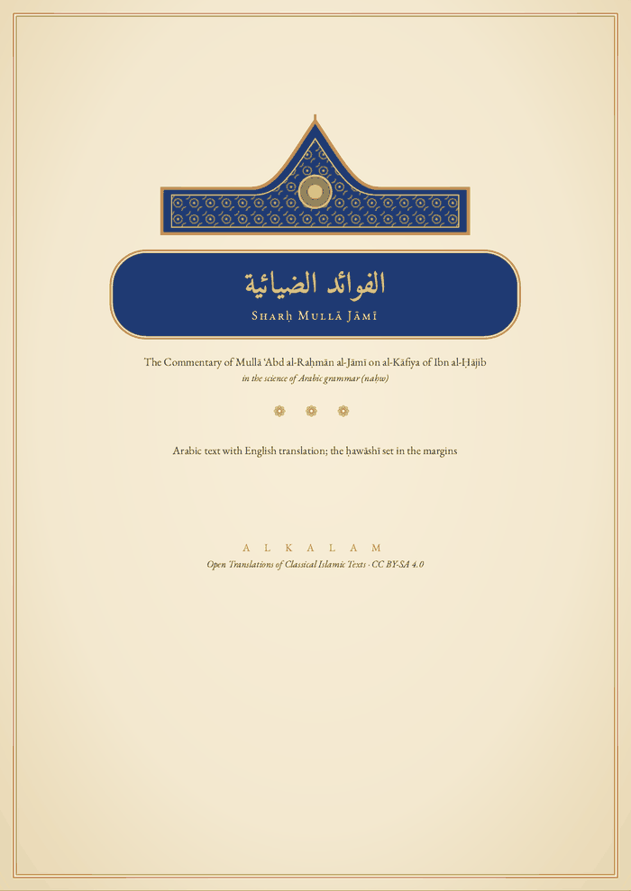
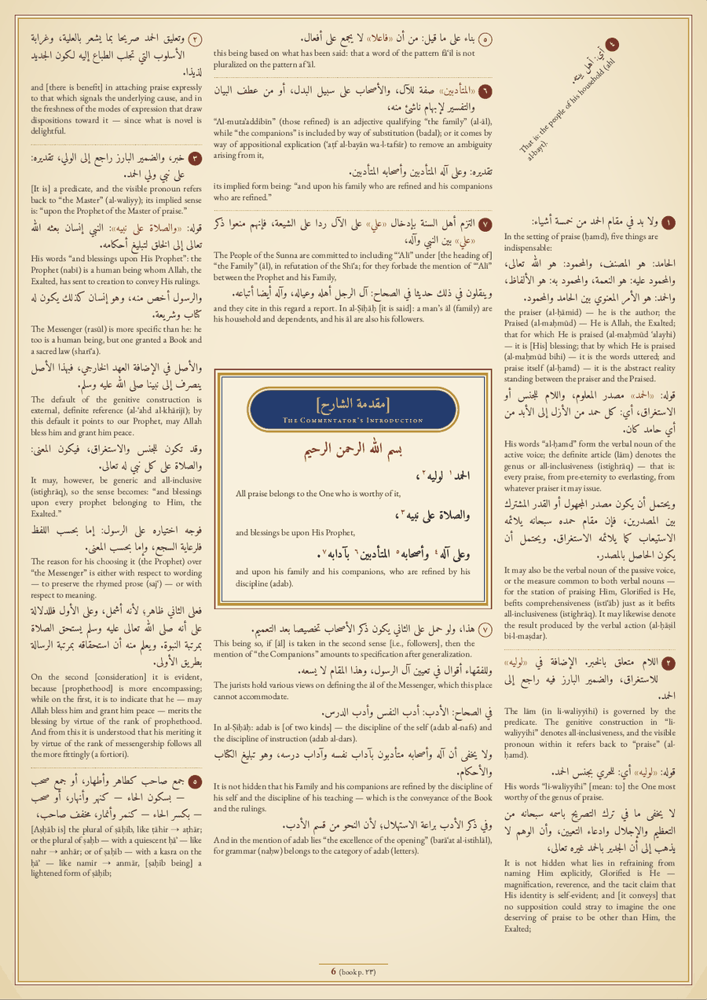
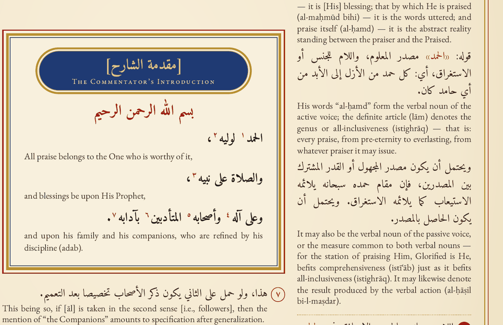
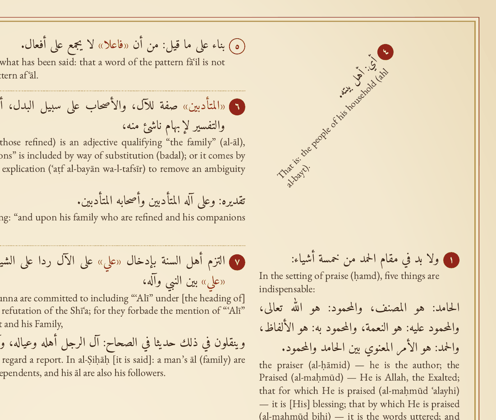
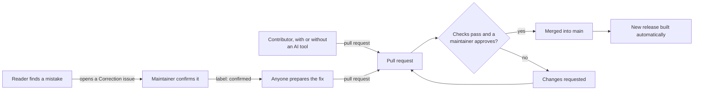

# Alkalam Open Translations

Arabic–English translations of classical Islamic texts, edited in the open.
Each book is translated sentence by sentence: the Arabic as printed in a named
edition, with the English beneath it, for both the main text (*matn*) and its
glosses (*ḥawāshī*). Anyone can download the books, report a mistake, correct
it, or propose a new book. Maintainers review and approve every change.

## Books

| Book | Author | Status | Pages | Download |
|---|---|---|---|---|
| [al-Fawāʾid al-Ḍiyāʾiyya (Sharḥ Mullā Jāmī)](books/mulla-jami/) | ʿAbd al-Raḥmān al-Jāmī (d. 898/1492) | complete | book pp. ٢٣–٥٩٩ | [PDF](https://github.com/maronesy/translation/releases/latest/download/Mulla-Jami_Manuscript.pdf) · [Word](https://github.com/maronesy/translation/releases/latest/download/Mulla-Jami_Translation.docx) · [Review notes](https://github.com/maronesy/translation/releases/latest/download/Mulla-Jami_Review-Notes.md) |

## Download

The PDF and Word files are not stored among the repository's files: they are
built automatically from the reviewed text and published on the
[Releases page](https://github.com/maronesy/translation/releases/latest)
(also under *Releases* in the right-hand sidebar of the repository's front
page). The download links in the table above always point to the newest
release. Keeping the built files out of the repository keeps it small, since
git would otherwise keep every version of a 27 MB PDF forever.

Every release has three files for each book:

| File | What it is |
|---|---|
| `<Book>_Manuscript.pdf` | A3 "manuscript" edition: the matn in a ruled central frame, the ḥawāshī (Arabic and English) set around it in the margins. Each sheet shows its PDF page number and, in brackets, the page of the printed edition. |
| `<Book>_Translation.docx` | Linear Word edition: each Arabic sentence followed by its English. |
| `<Book>_Review-Notes.md` | Places where the printed edition looks misprinted or a reading is uncertain, keyed to that release's PDF pages. |

A new release is published automatically each time a change is merged. The
links always point to the latest one.

## What the books look like

The manuscript edition of *Sharḥ Mullā Jāmī*, from the latest release:

| Cover | The opening of the commentary (book p. ٢٣) |
|---|---|
|  |  |

Each sheet sets the main text (*matn*) in a ruled central frame and its glosses
(*ḥawāshī*) around it, as in a glossed manuscript. Every Arabic sentence is
followed by its English.



*Close-up of the frame:* the section heading, the basmala, and the first
lines of the matn, each followed by its English. The red superscript numbers
mark the words the footnotes gloss; the glosses run in the margin beside it.



*Close-up of the margins:* short glosses are set diagonally in the corners,
the others in columns, each with its number in a red roundel.

## How the project works



- **`main` is protected.** Nothing reaches it except through a pull request
  that passes the automatic checks and is approved by a maintainer. No one
  else can merge.
- **Maintainers** are the people with write access to this repository. They
  review every pull request against the printed edition before approving it.
- **Contributors** work in one of two ways. They can read the printed page
  and type the Arabic and English into the page file themselves, in a text
  editor, using the project's scripts to read the scan, check the file and
  preview the result (see [Editing pages without AI](#editing-pages-without-ai)).
  Or they can have an AI assistant draft the edit and then verify it (see
  [Using AI tools](#using-ai-tools)). The scripts do not translate; in both
  cases the contributor is responsible for every line, and the maintainer
  review is the same.
- **Two checks must pass** before a pull request can be merged:
  - **Check pages** — every page file loads, its footnote markers match its
    footnotes, and the Arabic follows the book's rules (for example, no
    diacritics);
  - **Evidence** — a pull request that changes page files ticks the boxes
    confirming the contributor checked each changed line against the printed
    page and saying whether an AI tool was used; one that changes Arabic in
    existing pages also carries a photo of the printed page.

  Neither check can judge whether the Arabic matches the print or the English
  is faithful; the maintainer's review does that, with the photo in front of
  them. A preview PDF of the changed pages is attached to each pull request's
  checks.

## Report a mistake (no git needed)

1. Open a new issue and choose **Translation correction**
   ([direct link](https://github.com/maronesy/translation/issues/new?template=correction.yml)).
2. Fill in every field:
   - **Book**, and the **book page** printed on the sheet in brackets, e.g.
     `book p. ٣٠٥` (the PDF page alone is not enough, because it changes
     between releases);
   - **Where**: matn, or footnote number;
   - **What is wrong**: copy the current Arabic and/or English;
   - **Correction**: what it should say, and why;
   - **Photo of the printed page** if the Arabic transcription is in question.
     Arabic is only changed against the printed text, never from memory.
3. A maintainer checks the report. If it is right, they label it `confirmed`;
   if not, they explain why and close it.
4. A confirmed correction is fixed by a pull request — from the reporter,
   any other contributor, or a maintainer — following the next section. The
   pull request links the issue (`Fixes #123`), so the issue closes when it is
   merged and the next release includes the fix.

## Fix a mistake yourself (pull request)

1. **Fork** this repository on GitHub, then clone your fork:
   ```sh
   git clone https://github.com/<you>/translation.git
   cd translation
   pip install -r requirements.txt
   ```
2. **Create a branch** named `fix/<book>-p<book page>-<short-description>`:
   ```sh
   git switch -c fix/mulla-jami-p305-yastamil
   ```
3. **Find the page file.** Pages are stored by the page number of the scanned
   PDF of the edition: *scan page = book page + `pdf_offset`* (in the book's
   `book.toml`; it is 1 for Mullā Jāmī). Book page ٣٠٥ is therefore
   `books/mulla-jami/pages/page_306.py`.
4. **Edit only the blocks that are wrong.** Follow
   [docs/TRANSLATION-GUIDE.md](docs/TRANSLATION-GUIDE.md). In particular:
   - transcribe the Arabic exactly as printed; if the print itself looks wrong,
     keep it and add a `# REVIEW: …` comment above the block;
   - no diacritics in books whose `book.toml` says `diacritics = false`;
   - keep the `[[N]]` footnote markers and the `note` blocks in step.
5. **Run the checks** (and, if you like, build the book):
   ```sh
   python engine/check_page.py books/mulla-jami 306
   python engine/build_manuscript.py books/mulla-jami 306   # one-page preview PDF
   ```
6. **Commit** with a message of the form `<book>: book p.<page> <where> — <what>`:
   ```sh
   git commit -am "mulla-jami: book p.305 fn 6 — restore printed «يتسعمل», add REVIEW note"
   git push -u origin fix/mulla-jami-p305-yastamil
   ```
7. **Open a pull request** against `main`. Fill in the template, and link the
   issue it fixes (`Fixes #123`) if there is one. Tick the boxes. If you
   changed Arabic, drag a photo of the printed passage into the description,
   unless the linked issue already has one — the **Evidence** check fails
   without it. If it fails, edit the description; the check re-runs.
8. A maintainer reviews it. Answer any requested changes by pushing more
   commits to the same branch. Once the checks pass and a maintainer approves,
   it is merged.

## Propose a new book

1. **Open a proposal issue** — choose **New book proposal**
   ([direct link](https://github.com/maronesy/translation/issues/new?template=new-book.yml)).
   Give the title, author, the exact printed edition (publisher, year, ISBN)
   you will follow, the rights situation of that edition, and who will
   translate. Maintainers reply, and label the issue `book-accepted` if the
   project takes it on. Wait for this before doing a lot of work.
2. **Create a branch** named `book/<slug>`, where `<slug>` is a short
   lowercase name (e.g. `book/sharh-al-aqaid`), and copy the template:
   ```sh
   git switch -c book/sharh-al-aqaid
   cp -r books/_template books/sharh-al-aqaid
   ```
3. **Fill in `books/<slug>/book.toml`** (see [docs/NEW-BOOK.md](docs/NEW-BOOK.md))
   and `books/<slug>/README.md`.
4. **Put your own scan** of the edition at the path given by `local_scan`
   (inside `books/<slug>/source/`). It is git-ignored: **never commit scans.**
5. **Translate sample pages** — at least five consecutive pages, or the whole
   book — one file per scan page in `books/<slug>/pages/`, following
   [docs/TRANSLATION-GUIDE.md](docs/TRANSLATION-GUIDE.md). Check and build:
   ```sh
   python engine/check_page.py books/sharh-al-aqaid
   python engine/build_manuscript.py books/sharh-al-aqaid
   ```
6. **Open a pull request** titled `New book: <title>` and link the proposal
   issue. The checks attach a preview PDF. Maintainers review the sample
   against the edition; once approved and merged, the book appears in the next
   release with status `proposal` or `in-progress`.
7. **Continue in batches.** Translate further pages on branches named
   `book/<slug>-pp<first>-<last>` and open one pull request per batch.
   Set `status = "complete"` in the pull request that finishes the book.

## Editing pages without AI

Each page of the edition is one plain-text Python file,
`books/<slug>/pages/page_NNN.py`, holding a list of blocks: each sentence of
the main text, and of every footnote, as its Arabic with its English. You
edit these files directly. The full format is in
[docs/TRANSLATION-GUIDE.md](docs/TRANSLATION-GUIDE.md); a finished example is
[books/mulla-jami/pages/page_024.py](books/mulla-jami/pages/page_024.py).
A block looks like this:

```python
{"type": "matn",
 "ar": "المعنى يتوجهان إليه[[١]]، ويصح أن يكون هو مع وقوعه في ذلك الموضع[[٢]] معمولا لكل واحد منهما على البدل[[٣]].",
 "en": "…in respect of meaning are directed toward it; and it is valid that it … be governed by each one of the two [verbs] by way of alternation (ʿalā al-badal)."},
```

What you need:

- **A text editor that handles Arabic**, e.g. [VS Code](https://code.visualstudio.com/)
  (free). Arabic and English sit on the same line, so the editor must show
  right-to-left text correctly.
- **An Arabic keyboard layout**, enabled in your operating system's keyboard
  settings, for typing Arabic. Type the letters only: no diacritics in books
  that forbid them.
- **Python 3.11+** and the project's requirements, to run the scripts below
  (see [Working locally](#working-locally)).

The scripts, and what each does for you:

| Script | Does |
|---|---|
| `python engine/hires_page.py books/<slug> <scan page>` | Renders a page of **your own scan** in high-resolution strips, so dense footnotes are legible. It reads; it does not transcribe. |
| `python engine/check_page.py books/<slug> <scan page>` | Checks the file: it loads, footnote markers match footnotes, no forbidden diacritics. Run it after every edit. |
| `python engine/build_manuscript.py books/<slug> <scan page>` | Builds a PDF of just that page in the manuscript layout, so you can see your edit as readers will. |
| `python engine/build_docx.py books/<slug> <scan page>` | The same, as a Word file. |

A typical correction: find the page file (see step 3 of
[Fix a mistake yourself](#fix-a-mistake-yourself-pull-request)), change the
Arabic or English of the block concerned, run `check_page.py`, look at the
page with `build_manuscript.py`, then commit and open the pull request.

## Using AI tools

You may use any AI assistant to help transcribe, translate or correct pages —
for example Claude Code, OpenAI Codex, GitHub Copilot, Cursor or Gemini — or
none. The project does not run or pay for any AI service; you use your own.

1. Clone the repository (see above) and open it in your tool.
2. Point the tool at **[AGENTS.md](AGENTS.md)**: it gives the rules and
   procedures an AI assistant must follow here. Many tools read `AGENTS.md`
   automatically; Claude Code reads it through `CLAUDE.md`. For other tools,
   tell the assistant to read `AGENTS.md` and `docs/TRANSLATION-GUIDE.md`
   before it edits anything.
3. Give it the printed page: your own scan (rendered at high resolution with
   `python engine/hires_page.py books/<slug> <scan page>`) or a photo. An
   assistant must never supply Arabic from memory.
4. **Check its work yourself** against the printed page, line by line, and
   run `python engine/check_page.py books/<slug>`. AI tools misread dense
   Arabic, "correct" misprints silently and paraphrase; you are responsible
   for catching that.
5. Open the pull request as usual and **say which tool and model (with its
   version) you used** in the pull-request template.

Maintainers review AI-assisted pull requests exactly as others, and close
pull requests that show signs of unverified machine output.

### Choosing a model

Not every model is up to this work. A model used here must:

1. **read Arabic from images accurately**, including small, dense footnote
   type — it needs image input, used at high resolution;
2. **know classical Arabic and the technical vocabulary** of the science
   concerned (here, *naḥw*);
3. **follow instructions strictly** — keep misprints as printed, write no
   diacritics, change only what it is asked to;
4. if it works as an agent, **run the project's scripts and edit files**.

**What was used for Mullā Jāmī:** the whole translation was made with
**Claude Opus 5.5** (Anthropic), working in Claude Code, reading each page in
high-resolution strips with `engine/hires_page.py`. It is the only model tested
on this text so far. Other models are not yet tested here; that is not a
judgement on them.

**For any other model or tool:** use the provider's top tier — its largest or
highest-reasoning model with image input, whatever it is currently called.
Small and fast tiers (often named *mini*, *flash*, *lite*, *nano*, *haiku* or
similar) are not recommended for transcription unless they pass the
calibration test below. Model names and versions change every few months, so
the project keeps no list of approved models: test before you rely on one.

**Calibration test.** Before using a model on new pages, run it on pages that
are already in the repository, without letting it see the repository's
version, then score its output:

| Scan page | Book page | Why this page |
|---|---|---|
| 34 | ٣٣ | dense: ten footnotes |
| 306 | ٣٠٥ | contains a misprint (footnote ٦, «يتسعمل») that must be kept as printed |
| 320 | ٣١٩ | misprint in footnote ٣ («لاستقالها») |
| 339 | ٣٣٨ | misprint in the main text («متسايان») |

```sh
# the model writes its version of page 306 to /tmp/candidate_306.py, then:
python engine/compare_page.py books/mulla-jami 306 /tmp/candidate_306.py
```

`compare_page.py` reports the Arabic word accuracy (with every differing
word), whether the footnote markers match, whether flagged misprints were kept
as printed or silently "corrected", and any forbidden diacritics. Read the
English yourself against the reference. A model is fit for this work if, on
all four pages, it reaches **at least 99% Arabic word accuracy**, matches every
footnote marker, keeps every flagged misprint, and writes no diacritics.

The reference pages were themselves made with Claude Opus 5.5 and are still
being reviewed, so a disagreement is not automatically the candidate's error:
check the scan, and if the repository is wrong, open a correction. Record your
results — model, version, tool and scores — in
[docs/MODEL-RESULTS.md](docs/MODEL-RESULTS.md) (by pull request), and name the
model and version in the "AI tools" box of every pull request you make with it.

## Working locally

You need Python 3.11 or later, Google Chrome or Chromium (for the PDF), and
— only if you read a scan with the high-resolution tool — poppler's `pdftoppm`.

```sh
pip install -r requirements.txt
python engine/check_page.py books/mulla-jami            # check every page
python engine/build_docx.py books/mulla-jami            # → books/mulla-jami/build/*.docx
python engine/build_manuscript.py books/mulla-jami      # → books/mulla-jami/build/*.pdf
python engine/hires_page.py books/mulla-jami 306        # render a scan page in readable bands
```

Add page numbers to build only part of a book (e.g. `… books/mulla-jami 300 301 302`).
If Chrome is not found, set `CHROME=/path/to/chrome`.

## Repository layout

```
books/
  _template/              copy this to start a new book
  mulla-jami/
    book.toml             titles, edition, page range, rules
    README.md             about this book and its edition
    REVIEW-NOTES.md       readings to check against the print (book pages)
    pages/page_NNN.py     one file per scan page: Arabic + English blocks
    source/               your own scan goes here (git-ignored)
    build/                built files (git-ignored)
engine/                   build and check scripts, page template, fonts
docs/                     translation guide, new-book guide, maintainer guide
.github/                  issue forms, pull-request template, workflows
AGENTS.md                 rules for AI assistants (any tool)
CLAUDE.md                 points Claude Code to AGENTS.md
```

## Sources and rights

This repository contains **no scans**. Each book names the printed edition it
follows; contributors work from their own copies. The classical texts are in
the public domain; a modern edition's own contributions — its typesetting,
notes, and the selection and arrangement of glosses — may belong to its
publisher. If you hold rights in an edition used here and object to material
in this repository, open an issue or contact the maintainers and we will
remove it.

## License

- Translations and transcriptions (`books/`):
  [CC BY-SA 4.0](LICENSE-CONTENT.md). Reuse them with credit; share
  adaptations under the same license.
- Code (`engine/`, `.github/`): [MIT](LICENSE).
- Fonts (`engine/fonts/`): SIL Open Font License 1.1 — see
  [engine/fonts/README.md](engine/fonts/README.md).

See [CONTRIBUTING.md](CONTRIBUTING.md) for the review rules, and
[docs/MAINTAINERS.md](docs/MAINTAINERS.md) for repository setup.
